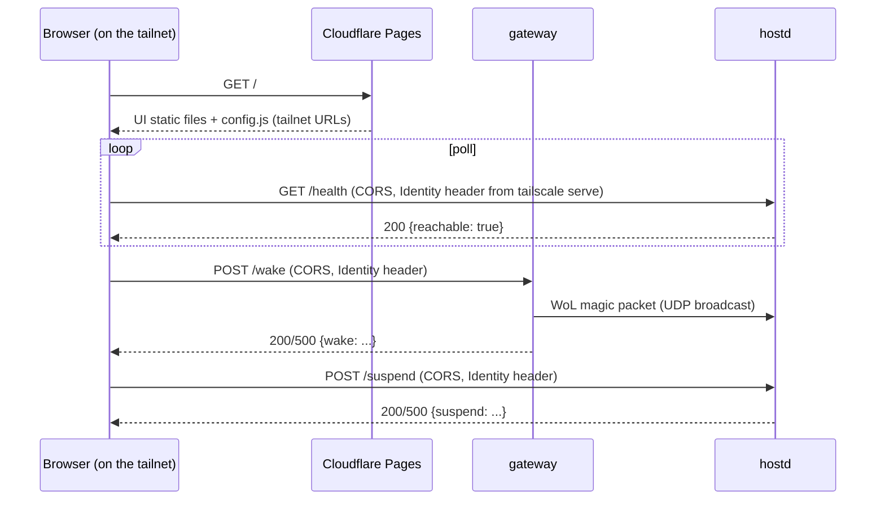
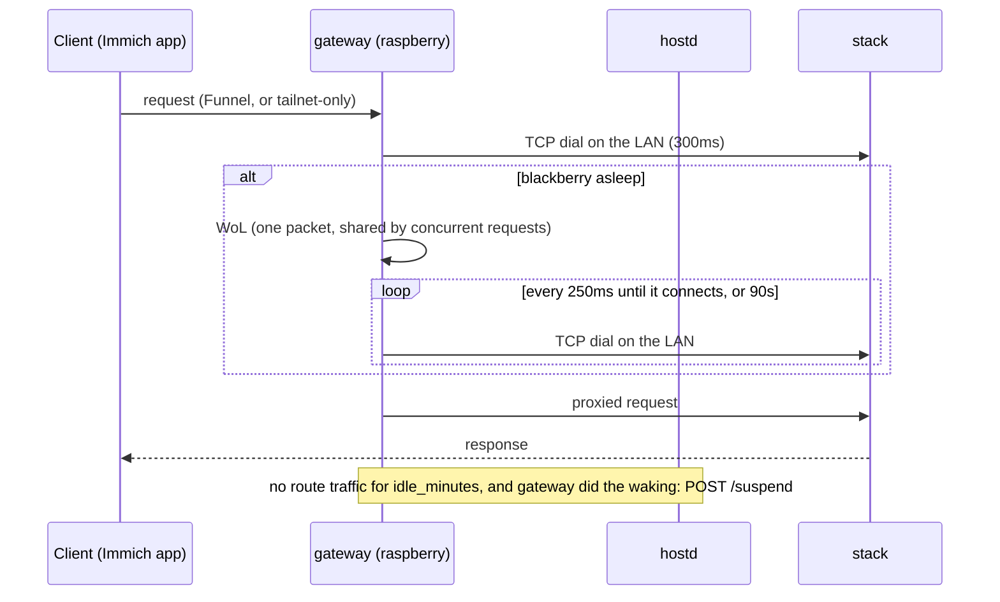

# Design

Why the system is shaped the way it is, and what it can't do. Overview: [README](README.md#how-it-works). Vocabulary: [`CONTEXT.md`](CONTEXT.md). Routes, environment and deployment per surface: [gateway](cmd/gateway/README.md), [hostd](cmd/hostd/README.md), [ui](ui/README.md), [deploy](DEPLOY.md), [stacks](https://github.com/nikbogman/deploys/blob/main/README.md).

## Request paths

Stacks in gateway's routes file are reached through gateway on raspberry, which wakes blackberry on the first request:

Workload traffic never touches hostd. On raspberry it goes only through gateway's stack routes, never its `/wake`.

Every wake, suspend and reachability change is logged as an event to Grafana Cloud. The services are stateless, so that's the only history.

## External integrations

| Integration | Purpose | Gotcha |
|---|---|---|
| **Tailscale** (`tailscale serve`) | TLS and identity injection in front of hostd, on blackberry. WoL is a raw LAN broadcast, not over Tailscale. | The browser's device must be on the tailnet as a user-owned node, or no identity is injected. |
| **Tailscale tsnet** | All of raspberry's tailnet presence: gateway's own node (`raspberry`, for `/wake`, `/settings`, path routes, and its calls to hostd) and one per hostname route (`<name>.<tailnet>.ts.net` on 443); Funnel for `public` ones. gateway sets the identity header from a `WhoIs` lookup. | Each node is a separate tailnet device and needs `TS_AUTHKEY` on first start; it must be a user-owned (untagged) key, or hostd sees no identity on gateway's calls. Funnel must be enabled in the tailnet policy. |
| **Cloudflare Pages** | Hosts the UI's static files (`task ui`, via `npx wrangler`). | Only the production origin (`UI_ORIGIN`) is allowed by CORS; preview deployments get other origins and can't call the backends. |
| **Grafana Cloud Loki** | Event log. | No local collector, no retry: a transient outage drops the event. |

## Design decisions

- **The browser calls gateway and hostd directly; no server relays.** The UI is static files on Cloudflare Pages and the browser, on a tailnet device, calls the backends at their `*.ts.net` URLs. gateway and hostd allow the UI's origin via CORS ([`internal/cors`](internal/cors/cors.go)). Every request carries the real user's identity header, set by `tailscale serve` (hostd) or a `WhoIs` lookup in gateway's tsnet node, so nothing ever forwards an identity. This replaced edge, a Go relay on Railway with its own `tsnet` node: it had no authentication, and needed a Railway volume and an MTU workaround. Cost: no Wake or Suspend from a device that isn't on the tailnet.
- **Tailnet membership is the whole authorization boundary.** No allow-list, and the public UI page itself grants nothing.
- **One tsnet hostname per gated stack by default; a path prefix only for APIs.** Per-app prefix support is inconsistent: Jellyfin wants the prefix kept, Immich refuses subpaths outright. That also ruled out a generic `/proxy/<stack>/` route. gateway runs an in-process tsnet node per route, so each gets `<name>.<tailnet>.ts.net` on 443, with no port limit and no Caddy on the Pi Zero. This replaced one HTTPS port per route on raspberry's single hostname, which capped Funnel routes at two (ports 8443, 10000). A route may instead set `path` (e.g. `/api`), served by gateway's own node beside `/wake`; gateway strips the prefix, so the stack sees `/`. That suits an API whose client just takes a base URL, not a web UI that emits absolute links. Path routes are always tailnet-only: Funnel is per node, so a public path route would put `/wake` on Funnel too. A stack without an `x-route` block isn't reachable from outside blackberry at all: gateway is the only way in. That replaced a Caddy stack (`caddy-tailscale`) that gave such stacks their own tsnet node with no auto-wake; once every reachable stack was gated, it served nothing. Cost: one node's RAM per route on the Pi, and a new tailnet device each.
- **One service on raspberry, gateway, for both kinds of Wake.** The UI's Wake and wake-on-request both end in the same WoL packet from the same device, so they share one binary, one unit and one config. Auto-wake lives there because raspberry is the always-on device. Wake is still never implicit: only routes flagged `wake` in a stack's `x-route` block trigger it, and the flag is the opt-in.
- **gateway holds the request instead of answering 503.** The Immich mobile app doesn't render a "waking" page and doesn't reliably retry background uploads, so the request waits up to 90s for blackberry. Only on timeout does it return 503 with `Retry-After`.
- **blackberry keeps its DHCP address through suspend.** Without `ignore-carrier` in [its netplan config](deployments/blackberry/netplan.yaml), systemd-networkd dropped the address when the link went down at suspend and re-ran DHCP on every wake: ~4.7s of a ~9s cold wake. The lease now renews in the background.
- **raspberry runs no tailscaled; gateway is its tailnet presence.** gateway's own tsnet node, `raspberry`, serves `/wake` and `/settings` and carries its calls to hostd; hostname routes were already tsnet nodes. One daemon on the Pi Zero instead of two, and nothing outside gateway to keep updated: a gateway release updates its Tailscale too. Costs: no Tailscale SSH to raspberry (deploys use its LAN address), the node's RAM, and identity checks for `/wake` are gateway's own `WhoIs` instead of `tailscale serve`'s. Path routes, formerly `tailscale serve --set-path`, are now a prefix on that node's mux.
- **gateway checks the stack's own port on the LAN, not hostd over the tailnet.** A TCP dial to the upstream takes ~15ms; a fresh TLS call to hostd from the Pi Zero takes ~0.7s, and after resume also waits for tailscaled to reconnect. It also proves the stack itself is up, not just blackberry. 300ms per check, every 250ms. Cold wake went from ~17s to ~8–9s. hostd is still used for `/suspend`.
- **Wake-path events ship after the packet, or in the background.** `SendEvent` is a synchronous HTTPS call to Grafana; on the Pi Zero it delayed both the WoL and the release of held requests.
- **No shared state between raspberry and blackberry.** Awake is derived by probing the stack, not stored. The route table is a file shipped by `task gateway`. A single gateway process makes one WoL per burst with an in-memory lock, so there's no Redis or other store.
- **Routes are declared in each stack's `compose.yml`, not in this repo.** A top-level `x-route` block (a Compose extension field, ignored by Docker) holds the route fields; `cmd/routes` reads every stack in the [deploys](https://github.com/nikbogman/deploys) repo with `docker compose config --format json`, takes the upstream from the service's published port, and generates both gateway's routes file and stack-firewall's `PORTS`. The port lives in one place, so the three copies that used to drift (compose, routes file, firewall) can't. `docker compose config` resolves the `.env` interpolation locally, without Docker or blackberry, and returns JSON, so this repo stays stdlib-only, with no YAML parser. Cost: `task gateway` and `task firewall` need a checkout of the stacks repo and each stack's `.env` (`STACKS_DIR`, default `../deploys`).
- **gateway auto-suspends only what it auto-woke.** After `idle_minutes` with no request in flight and none finished, gateway calls hostd `/suspend`, but only if its own auto-wake brought blackberry up. A manual Wake from the UI is never undone behind your back.
- **Idle time is per route, shorter for stacks that never touch the HDD.** A route's request keeps blackberry up for that route's `idle_minutes`, and never shortens a longer one already running. An SSD-only stack can set e.g. 10 min; Immich (library on the HDD) keeps the 30-min default, matching `hd-idle`'s spin-down so a spun-up drive isn't suspended mid-idle. Fewer awake hours on the SSD-only path, same spin-up count on the HDD path.
- **Auto-wake and auto-suspend are runtime switches, in gateway's memory.** Set from the UI via `/settings`. A restart turns both back on; persisting them isn't worth a state file on the Pi yet.
- **Public vs tailnet-only is per route.** Path routes share 443 and are never public. A `public` hostname route listens with Funnel; the rest accept tailnet callers only. A tailnet-only route is never on Funnel, and gateway sets its identity header from a `WhoIs` lookup (hostname routes) or Tailscale injects it (path routes), rejecting any request without it.
- **One Postgres and one Valkey for all of blackberry ([`db` stack](https://github.com/nikbogman/deploys/tree/main/db)).** Fewer containers, one place to back up, and less RAM on an 8GB machine. The image is the official Postgres 17 plus pgvector (`pgvector/pgvector`), not Immich's own Postgres 14 + VectorChord build: Immich needs a vector extension for its schema even with machine learning off, and auto-detects pgvector. VectorChord is faster for smart search; switch to `tensorchord/vchord-postgres` if machine learning is ever turned on. Costs: the Postgres version must stay in Immich's supported range (14–19); Immich's role is a superuser (Immich requires it), so it can read every other stack's database, and Immich's built-in backup (`pg_dumpall`) dumps them all. Valkey separates stacks by DB index, not by user.
- **Suspend-to-RAM only.** WoL after full shutdown (ACPI S5) is unreliable across BIOS/NIC configs. The suspend command isn't configurable.
- **No workload drain before suspend.** Suspend-to-RAM freezes every process and resumes it in place, so nothing is torn down. In-flight requests stall, though, and can run twice on retry; see [hostd](cmd/hostd/README.md#suspend-never-waits-for-in-flight-work).
- **The HDD spins down via `hd-idle`, not the drive's own timer.** The WD10EZEX ignores `hdparm -S` (tested), so `hd-idle` sends ATA standby after 30 min without I/O ([`deployments/blackberry/hd-idle`](deployments/blackberry/hd-idle)), and a system-sleep hook restarts it on resume, when the drive powers up spinning. `/mnt/hdd` is mounted `noatime` so reads don't cause writes. 30 min, not less: each spin-up wears the drive too.
- **WoL needs one L2 broadcast domain.** Accepted rather than building a cross-subnet relay.
- **Events go straight to Grafana Cloud.** A self-hosted collector isn't worth it for low-volume audit events.
- **Go binaries under systemd for gateway and hostd.** No runtime to install on a Pi Zero, and hostd must stay controllable while Docker itself redeploys.
- **The UI has no build step.** Static files uploaded verbatim; the only generated file is `config.js`, the backends' tailnet URLs, written by `task ui` from `.env` so the tailnet name stays out of the repo. Node is needed only on the dev machine, for `npx wrangler`.
- **Deploys are manual only, except what updates by pull.** A Deploy (`task`) sets devices up and ships units, environment and secrets. Stacks, routes and the two binaries update themselves by polling, because blackberry sleeps and nothing outside the LAN can reach either device: a push would have nowhere to land. Unit and environment changes stay manual: a bad one can't roll itself back.
- **hostd deploys the Stacks.** It pulls deploys every few minutes while awake and runs `docker compose` for the folders that changed. In hostd rather than a timer and script, so events, error handling and the routes file share code with the rest; it still decides from the repo alone, never from Docker's state. A fresh clone adopts `main` as deployed instead of applying it, so enabling the sync changes nothing that's running. A failed stack isn't retried until the next push touching it: a retry every poll would spam events and pull loops.
- **gateway gets its routes from hostd, not GitHub.** hostd has the clone, Docker and the decrypted `.env` files that `docker compose config` needs, so `GET /routes` serves the same file `cmd/routes` makes on a dev machine. It answers only while blackberry is awake, which is the only time stacks change. The alternative, CI publishing the file to a release in the private deploys repo, needed a GitHub token on the Pi that expires every year.
- **gateway and hostd update from tagged releases, with rollback.** Release builds poll the `/releases/latest` redirect (not the API: 60 requests an hour per IP, shared by both devices), verify `SHA256SUMS`, and swap by rename. Tags, not every push, because gateway is the only way to wake blackberry. Only binaries whose version is a release tag update, so a local build is pinned by construction, and a manual Deploy is never silently reverted. Three failed starts in a minute restore `.prev`, and the failed release is never reinstalled. A release that starts but misbehaves isn't caught; recovery is `task gateway` over the LAN.
- **gateway saves its switches and auto-wake flag to a file.** Updates restart it routinely; without the file, a restart after an auto-wake would leave blackberry up for good, and the UI's switches would silently turn back on.
- **Stack secrets are in git, encrypted with sops + age.** One copy, with history and an off-machine backup, and a secret change deploys on push like any other. Two age keys: the dev machine's and blackberry's, which never leaves it. GitHub Actions secrets don't work here: only a workflow can read them, and no workflow can reach a sleeping blackberry. gateway's and hostd's own secrets stay plain dev-machine env vars, shipped by a Deploy: one operator, and they change rarely.

## Security

- **The UI page is public, but grants nothing:** its `config.js` reveals the tailnet's hostnames, and only tailnet members can reach them.
- **A public gateway route with `wake` is a public wake trigger:** anyone who finds the Funnel URL can wake blackberry, which then stays up for `idle_minutes`. Flag `wake` only on routes that need it, and make the rest tailnet-only.
- gateway and hostd refuse to start unless bound to loopback or a tailnet address.
- **Gated stacks are reachable on the LAN only from raspberry.** They publish plain HTTP on blackberry's LAN IP, so [`stack-firewall`](deployments/blackberry/stack-firewall.service) (`task firewall`) drops connections to their ports from any other source. The rule is in Docker's `DOCKER-USER` chain, because published ports bypass ufw and `INPUT`, and matches the pre-DNAT port with conntrack, Docker's documented pattern. The unit is `PartOf=docker.service`, so the rule is re-added whenever Docker restarts. blackberry itself can still reach them (its traffic doesn't go through `FORWARD`). hostd keeps `PORTS` current from the synced stacks through a drop-in; `task firewall` sets the same from a dev machine.
- CORS is an allow-list of one origin, `UI_ORIGIN`. It's not auth: requests from other origins still reach the handler, which requires the identity header, and the browser just hides the response.
- `/wake` also accepts a loopback caller with no identity (see Identity header in [`CONTEXT.md`](CONTEXT.md)).

## Known limitations

- Wake and Suspend from the UI work only on a tailnet device. Browsers that restrict public pages calling private addresses (Chrome's local network access) may prompt or block, since `*.ts.net` resolves to 100.x addresses.
- Wake is manual, except on gateway routes flagged `wake`. Any other request to a sleeping blackberry just fails.
- gateway sends one WoL packet per wake. If it's lost, requests wait out the 90s timeout and get a 503.
- A cold wake takes ~6.5s: ~1.1s TLS on the Pi Zero (once per new connection; measured with `tailscale serve`, now gateway's tsnet node), ~2.7s firmware resume, ~2.2s for the gigabit link to train, ~0.5s until the stack answers. None of it is software on blackberry any more.
- gateway's idle timer sees only its routes' traffic: Immich's background jobs, or a stack used directly on the tailnet, don't keep blackberry awake, and suspend stalls them (see No workload drain).
- gateway's upstreams must be reachable from raspberry over the LAN: a port on blackberry's LAN IP.
- If raspberry and blackberry end up on different broadcast domains, WoL silently stops working.
- hostd can log blackberry becoming reachable, never unreachable: it's asleep whenever that happens.
- The bind-address check runs at startup only; `task` doesn't verify it.
- Single operator, one blackberry, no concurrent deploys.
- Polls use Go's monotonic clock, which stops in suspend: the first sync and update check after a wake can be up to `UPDATE_MINUTES` late.
- A push lands only when blackberry next wakes. A stack sync can be frozen mid-pull by an auto-suspend; it resumes on wake.
- gateway can't see a broken release until it fails to start. A `/wake` that's broken but running stays deployed.
- Losing the dev machine's age key together with blackberry's disk loses every stack secret.
