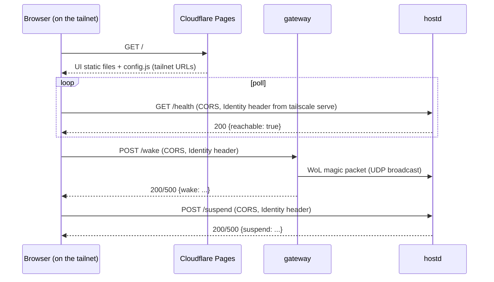
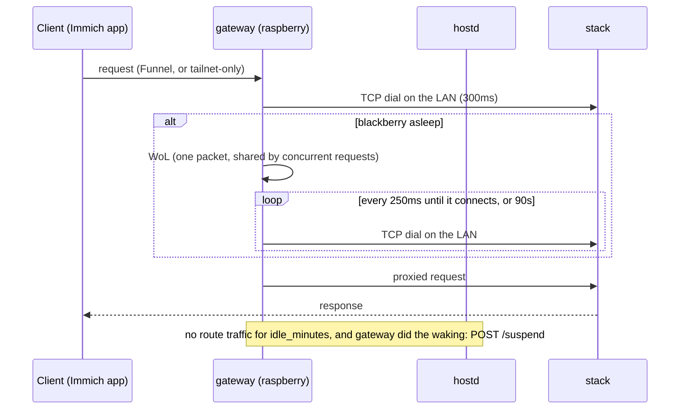

# Design

Why the system is shaped the way it is, and what it can't do. Overview: [README](README.md#how-it-works). Vocabulary: [`CONTEXT.md`](CONTEXT.md). Routes, environment and deployment per surface: [gateway](cmd/gateway/README.md), [hostd](cmd/hostd/README.md), [ui](ui/README.md), [deploy](DEPLOY.md), [stacks](stacks/README.md).

## Request paths

Stacks in gateway's routes file are reached through gateway on raspberry, which wakes blackberry on the first request:

Workload traffic never touches hostd. On raspberry it goes only through gateway's stack routes, never its `/wake`.

Every wake, suspend and reachability change is logged as an event to Grafana Cloud. The services are stateless, so that's the only history.

## External integrations

| Integration | Purpose | Gotcha |
|---|---|---|
| **Tailscale** (`tailscale serve`) | TLS and identity injection in front of gateway and hostd. WoL is a raw LAN broadcast, not over Tailscale. | The browser's device must be on the tailnet as a user-owned node, or `tailscale serve` injects no identity. |
| **Tailscale Funnel** | Public HTTPS for gateway's `public` routes, from raspberry's one hostname. | Only ports 443, 8443 and 10000, and 443 is taken by gateway's own `/wake`, so at most two public routes. Needs Funnel enabled in the tailnet policy. |
| **Cloudflare Pages** | Hosts the UI's static files (`task ui`, via `npx wrangler`). | Only the production origin (`UI_ORIGIN`) is allowed by CORS; preview deployments get other origins and can't call the backends. |
| **Grafana Cloud Loki** | Event log. | No local collector, no retry: a transient outage drops the event. |

## Design decisions

- **The browser calls gateway and hostd directly; no server relays.** The UI is static files on Cloudflare Pages and the browser, on a tailnet device, calls the backends at their `*.ts.net` URLs. gateway and hostd allow the UI's origin via CORS ([`internal/cors`](internal/cors/cors.go)). Every request carries the real user's identity header, set by `tailscale serve`, so nothing ever forwards an identity. This replaced edge, a Go relay on Railway with its own `tsnet` node: it had no authentication, and needed a Railway volume and an MTU workaround. Cost: no Wake or Suspend from a device that isn't on the tailnet.
- **Tailnet membership is the whole authorization boundary.** No allow-list, and the public UI page itself grants nothing.
- **One port per gated stack, not path prefixes.** Per-app prefix support is inconsistent: Jellyfin wants the prefix kept, Immich refuses subpaths outright. That also ruled out a `/proxy/<stack>/` route. gateway gives each route its own HTTPS port on raspberry's single hostname. Stacks not in gateway's routes file keep their own tsnet node via Caddy (`caddy-tailscale`), tailnet-only and with no auto-wake.
- **One service on raspberry, gateway, for both kinds of Wake.** The UI's Wake and wake-on-request both end in the same WoL packet from the same device, so they share one binary, one unit and one config. Auto-wake lives there because raspberry is the always-on device. Wake is still never implicit: only routes flagged `wake` in [`cmd/gateway/routes.json`](cmd/gateway/routes.json) trigger it, and the flag is the opt-in.
- **gateway holds the request instead of answering 503.** The Immich mobile app doesn't render a "waking" page and doesn't reliably retry background uploads, so the request waits up to 90s for blackberry. Only on timeout does it return 503 with `Retry-After`.
- **blackberry keeps its DHCP address through suspend.** Without `ignore-carrier` in [its netplan config](deployments/blackberry/netplan.yaml), systemd-networkd dropped the address when the link went down at suspend and re-ran DHCP on every wake: ~4.7s of a ~9s cold wake. The lease now renews in the background.
- **gateway checks the stack's own port on the LAN, not hostd over the tailnet.** A TCP dial to the upstream takes ~15ms; a fresh TLS call to hostd from the Pi Zero takes ~0.7s, and after resume also waits for tailscaled to reconnect. It also proves the stack itself is up, not just blackberry. 300ms per check, every 250ms. Cold wake went from ~17s to ~8–9s. hostd is still used for `/suspend`.
- **Wake-path events ship after the packet, or in the background.** `SendEvent` is a synchronous HTTPS call to Grafana; on the Pi Zero it delayed both the WoL and the release of held requests.
- **No shared state between raspberry and blackberry.** Awake is derived by probing the stack, not stored. The route table is a file shipped by `task gateway`. A single gateway process makes one WoL per burst with an in-memory lock, so there's no Redis or other store.
- **gateway auto-suspends only what it auto-woke.** After `idle_minutes` with no request in flight and none finished, gateway calls hostd `/suspend`, but only if its own auto-wake brought blackberry up. A manual Wake from the UI is never undone behind your back.
- **Public vs tailnet-only is per route, by port.** `public` routes are published with `tailscale funnel`, the rest with `tailscale serve` only. A tailnet-only route is never on Funnel, so the identity header is always injected by Tailscale and gateway rejects any request without it.
- **One Postgres and one Valkey for all of blackberry ([`stacks/db`](stacks/db/)).** Fewer containers, one place to back up, and less RAM on an 8GB machine. The image is the official Postgres 17 plus pgvector (`pgvector/pgvector`), not Immich's own Postgres 14 + VectorChord build: Immich needs a vector extension for its schema even with machine learning off, and auto-detects pgvector. VectorChord is faster for smart search; switch to `tensorchord/vchord-postgres` if machine learning is ever turned on. Costs: the Postgres version must stay in Immich's supported range (14–19); Immich's role is a superuser (Immich requires it), so it can read every other stack's database, and Immich's built-in backup (`pg_dumpall`) dumps them all. Valkey separates stacks by DB index, not by user.
- **Suspend-to-RAM only.** WoL after full shutdown (ACPI S5) is unreliable across BIOS/NIC configs. The suspend command isn't configurable.
- **No workload drain before suspend.** Suspend-to-RAM freezes every process and resumes it in place, so nothing is torn down. In-flight requests stall, though, and can run twice on retry; see [hostd](cmd/hostd/README.md#suspend-never-waits-for-in-flight-work).
- **The HDD spins down via `hd-idle`, not the drive's own timer.** The WD10EZEX ignores `hdparm -S` (tested), so `hd-idle` sends ATA standby after 30 min without I/O ([`deployments/blackberry/hd-idle`](deployments/blackberry/hd-idle)), and a system-sleep hook restarts it on resume, when the drive powers up spinning. `/mnt/hdd` is mounted `noatime` so reads don't cause writes. 30 min, not less: each spin-up wears the drive too.
- **WoL needs one L2 broadcast domain.** Accepted rather than building a cross-subnet relay.
- **Events go straight to Grafana Cloud.** A self-hosted collector isn't worth it for low-volume audit events.
- **Go binaries under systemd for gateway and hostd.** No runtime to install on a Pi Zero, and hostd must stay controllable while Docker itself redeploys.
- **The UI has no build step.** Static files uploaded verbatim; the only generated file is `config.js`, the backends' tailnet URLs, written by `task ui` from `.env` so the tailnet name stays out of the repo. Node is needed only on the dev machine, for `npx wrangler`.
- **Deploys are manual only.** No CI, cron or hooks: unattended deploys aren't worth the risk on two devices.
- **Secrets are plain dev-machine env vars.** One operator; an encrypted-secrets workflow isn't needed.

## Security

- **The UI page is public, but grants nothing:** its `config.js` reveals the tailnet's hostnames, and only tailnet members can reach them.
- **A public gateway route with `wake` is a public wake trigger:** anyone who finds the Funnel URL can wake blackberry, which then stays up for `idle_minutes`. Flag `wake` only on routes that need it, and make the rest tailnet-only.
- gateway and hostd refuse to start unless bound to loopback or a tailnet address.
- **Gated stacks are reachable on the LAN only from raspberry.** They publish plain HTTP on blackberry's LAN IP, so [`stack-firewall`](deployments/blackberry/stack-firewall.service) (`task firewall`) drops connections to their ports from any other source. The rule is in Docker's `DOCKER-USER` chain, because published ports bypass ufw and `INPUT`, and matches the pre-DNAT port with conntrack, Docker's documented pattern. The unit is `PartOf=docker.service`, so the rule is re-added whenever Docker restarts. blackberry itself can still reach them (its traffic doesn't go through `FORWARD`). Adding a gated stack means adding its port to `PORTS` in the unit.
- CORS is an allow-list of one origin, `UI_ORIGIN`. It's not auth: requests from other origins still reach the handler, which requires the identity header, and the browser just hides the response.
- `/wake` also accepts a loopback caller with no identity (see Identity header in [`CONTEXT.md`](CONTEXT.md)).

## Known limitations

- Wake and Suspend from the UI work only on a tailnet device. Browsers that restrict public pages calling private addresses (Chrome's local network access) may prompt or block, since `*.ts.net` resolves to 100.x addresses.
- Wake is manual, except on gateway routes flagged `wake`. Any other request to a sleeping blackberry just fails.
- gateway sends one WoL packet per wake. If it's lost, requests wait out the 90s timeout and get a 503.
- A cold wake takes ~6.5s: ~1.1s TLS in `tailscale serve` on the Pi Zero (once per new connection), ~2.7s firmware resume, ~2.2s for the gigabit link to train, ~0.5s until the stack answers. None of it is software on blackberry any more.
- gateway's idle timer sees only its routes' traffic: Immich's background jobs, or a stack used directly on the tailnet, don't keep blackberry awake, and suspend stalls them (see No workload drain).
- gateway's upstreams must be reachable from raspberry: blackberry's tailnet or LAN address, or a stack's own Caddy tsnet hostname.
- If raspberry and blackberry end up on different broadcast domains, WoL silently stops working.
- hostd can log blackberry becoming reachable, never unreachable: it's asleep whenever that happens.
- The bind-address check runs at startup only; `task` doesn't verify it.
- Single operator, one blackberry, no concurrent deploys.
